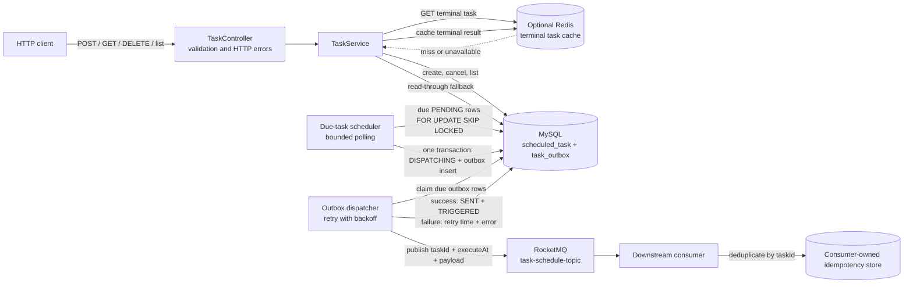
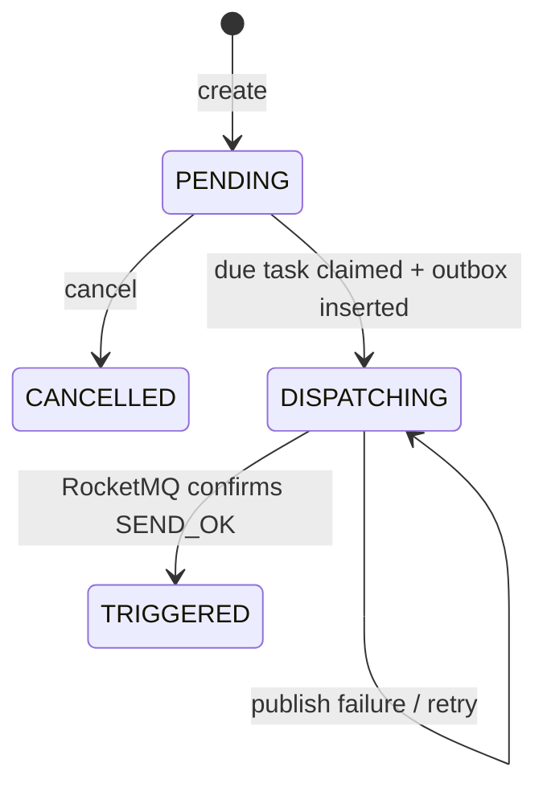

# Task Scheduling Service

A Java 21 / Spring Boot REST API for scheduling tasks. MySQL is the source of truth; an optional Redis cache speeds up reads of terminal tasks, and a transactional outbox retries delivery to RocketMQ.

## Architecture



### End-to-end flow

1. `POST /tasks` validates a unique task ID, a future execution time, and a JSON payload, then inserts a `PENDING` row into MySQL.
2. The scheduler polls due tasks in small, ordered batches. It locks rows with `SKIP LOCKED`, changes `PENDING` to `DISPATCHING`, and inserts the matching outbox event in the **same database transaction**. A concurrent cancellation can only change a still-`PENDING` row.
3. The outbox dispatcher publishes each due event to RocketMQ. Only a broker `SEND_OK` response is treated as success. Success marks the outbox row `SENT` and task `TRIGGERED`; failures keep the event pending and schedule a capped exponential-backoff retry.
4. Delivery is **at least once**, not exactly once. A crash after the broker accepts a message but before MySQL commits can cause a repeat. Consumers should deduplicate using the task ID (also sent as the message key and `idempotencyKey` property).
5. Redis is optional and disabled by default. When enabled it caches **only immutable terminal results** (`TRIGGERED` and `CANCELLED`). A cache miss or Redis outage falls back to MySQL; Redis never owns task or scheduling state.

Task state transitions:



## Requirements and startup

- Java 21+
- Docker with Docker Compose

To build and run the API and its dependencies in containers:

```shell
docker compose --profile app up --build -d
```

To start only the backing services and run the API from the command line:

```shell
docker compose up -d
./mvnw spring-boot:run
```

On Windows, use `mvnw.cmd spring-boot:run`. The API listens on port 8080 by default. The `app` Compose profile exposes port 8080 and waits for MySQL to become healthy before starting; the outbox retries delivery while RocketMQ starts. If you have an older database volume, `CREATE TABLE IF NOT EXISTS` will not migrate it; apply schema changes to that database before upgrading.

The Compose credentials (`taskuser` / `taskpass`) are for local development only. Do not use them in a deployed environment.

Configuration can be overridden with environment variables:

| Variable | Default | Purpose |
| --- | --- | --- |
| `DB_URL` | `jdbc:mysql://localhost:3306/taskdb?...` | MySQL JDBC URL |
| `DB_USERNAME` / `DB_PASSWORD` | `taskuser` / `taskpass` | MySQL credentials |
| `REDIS_HOST` / `REDIS_PORT` | `localhost` / `6379` | Redis connection |
| `REDIS_CACHE_ENABLED` | `false` | Enable terminal-task Redis cache |
| `REDIS_CACHE_TTL_SECONDS` | `300` | Cache entry lifetime |
| `ROCKETMQ_NAMESRV_ADDR` | `localhost:9876` | RocketMQ NameServer |
| `ROCKETMQ_PRODUCER_GROUP` | `task-scheduling-producer` | Producer group |
| `ROCKETMQ_TOPIC` | `task-schedule-topic` | Trigger topic |
| `SERVER_PORT` | `8080` | HTTP port |
| `APP_PORT` | `8080` | Host port when using the Compose app profile |
| `SCHEDULER_POLL_INTERVAL_MS` | `1000` | Due-task polling interval |
| `SCHEDULER_BATCH_SIZE` | `100` | Due-task batch size |
| `OUTBOX_POLL_INTERVAL_MS` | `1000` | Outbox polling interval |
| `OUTBOX_BATCH_SIZE` | `100` | Outbox batch size |
| `OUTBOX_MAX_BACKOFF_SECONDS` | `300` | Maximum retry delay |

`schema.sql` creates the tables and basic status constraints on application startup. `init.sql` provides the same schema for a fresh Compose MySQL volume.

## API

Create a task with a caller-provided unique ID and future execution time:

```shell
curl -X POST http://localhost:8080/tasks \
  -H "Content-Type: application/json" \
  -d '{"taskId":"abc-123","executeAt":"2030-07-21T15:00:00Z","payload":{"type":"email","target":"hello@example.com"}}'
```

- `POST /tasks` creates a task and returns `201 Created`.
- `GET /tasks/{taskId}` gets a task.
- `DELETE /tasks/{taskId}` cancels a pending task. Repeating cancellation is safe; tasks already dispatching or triggered return `409 Conflict`.
- `GET /tasks?status=PENDING&page=0&size=20` lists a status-filtered page. Status values are `PENDING`, `DISPATCHING`, `TRIGGERED`, and `CANCELLED`; page size is limited to 100.

Malformed or invalid input (including a non-future `executeAt`, invalid status, or invalid pagination) returns `400`. Missing tasks return `404`; duplicate IDs and tasks that can no longer be cancelled return `409`. Errors use Spring's `ProblemDetail` format.

## Tests and coverage

Run all unit and MVC-slice tests and generate the JaCoCo report:

```shell
./mvnw clean verify
```

On Windows, run `mvnw.cmd clean verify`. The HTML coverage report is written to `target/site/jacoco/index.html`; it is generated locally and is not committed. The current suite has **45 tests and 92.6% line coverage** (JaCoCo; 96.7% branch coverage). Tests cover HTTP request validation and status codes, task service state rules and pagination, JDBC SQL/mapping behavior, Redis cache failures and fallback, due-task/outbox creation, retry/backoff behavior, and RocketMQ message metadata and send-status handling.

These tests do not require running MySQL, Redis, RocketMQ, or Docker. Consequently they do not prove the real MySQL schema/locking behavior or exercise a live broker; those integration checks are the remaining step for a full environment-level verification.
